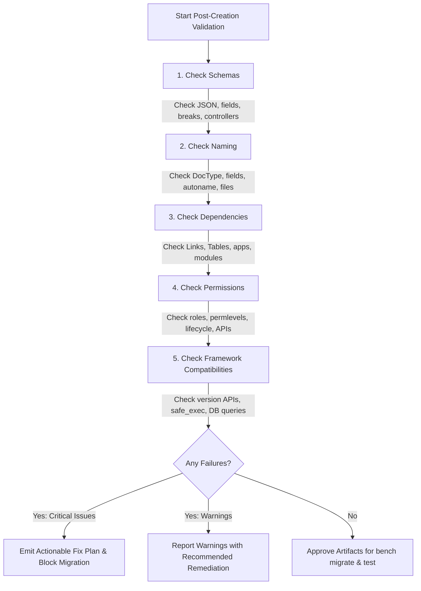

# Frappe Post-Creation Validation

Perform rigorous, systematic verification of generated or modified Frappe application artifacts—DocTypes, Workflows, Client Scripts, Server Scripts, Custom Fields, and `hooks.py` registrations—immediately after creation and before running `bench migrate` or deploying.

---

## 1. Schema Validation

Verify that JSON schemas, DocType definitions, and metadata structures strictly adhere to Frappe framework specifications.

### DocType JSON Schema Checklist

- [ ] **Top-Level Required Keys**: Ensure all mandatory keys exist:
  - `name`: Matches DocType name exactly.
  - `doctype`: Must be `"DocType"`.
  - `module`: Target module exists in the app's `modules.txt`.
  - `engine`: Typically `"InnoDB"`.
  - `field_order`: List of all `fieldname` strings in the exact display sequence, including all break fields.
  - `fields`: Array of field definition dictionaries.
  - `permissions`: Array of permission dictionaries (required for standard, non-child, non-single DocTypes).
- [ ] **DocType Configuration Flags**:
  - `istable`: Set to `1` only for Child Tables (must NOT have `is_submittable: 1` or independent permissions).
  - `issingle`: Set to `1` only for Single DocTypes (stored as key-value in `tabSingles`, no database table).
  - `is_submittable`: Set to `1` only if the document follows the Submit/Cancel workflow (`docstatus` 0 → 1 → 2).
  - `is_tree`: Configured with proper parent and NSM (Nested Set Model) fields if enabled.
  - `custom`: `0` for core app DocTypes shipped in repository; `1` for site-level Custom DocTypes.

### Field-Level Schema & Type Constraints

Validate every entry in the `fields` array against Frappe's field type specifications:

| Field Type | Required Properties & Constraints | Common Failure Modes |
|---|---|---|
| `Link` | `options` MUST specify the exact target DocType name | Empty `options`, pointing to non-existent DocType, or linking to a Child Table |
| `Table` / `Table MultiSelect` | `options` MUST point to a valid Child DocType (`istable: 1`) | Pointing to a standard DocType or empty `options` |
| `Dynamic Link` | `options` MUST specify the fieldname holding the dynamic DocType | Pointing to a DocType name instead of a fieldname |
| `Select` | `options` MUST contain newline-separated string options | Comma-separated options, missing default when options don't allow blank |
| `Currency` | Optional `options` for Currency field reference; specify `precision` | Storing monetary values in `Float` or `Data` |
| `Check` | Default must be `"0"` or `"1"` | String Booleans (`"true"`, `"false"`) |
| `Date` / `Datetime` / `Time` | Correct temporal type matching business requirement | Storing timestamps in `Data` fields |
| `Section Break` / `Column Break` / `Tab Break` | Must be logically paired; cannot have consecutive empty layout breaks | Break fields missing from `field_order` |
| `Read Only` | Read-only property configured; computed or static | Editable fields marked as read-only without compute logic |

### Schema Structural Integrity Checks

- [ ] **Field Order Completeness**: Every field defined in `fields` must appear in `field_order`, and every field in `field_order` must exist in `fields`. No phantom or omitted fields.
- [ ] **Controller & Metadata Alignment**:
  - Controller class in `{doctype}.py` inherits from `frappe.model.document.Document` (or `NestedSet`).
  - Python class name matches the PascalCase / spaced DocType name (e.g., `DocType: "Library Member"` → `class LibraryMember(Document):`).
  - File resides in the expected module path: `[app]/[module]/doctype/[doctype_name]/[doctype_name].json`.

---

## 2. Naming Conventions Validation

Enforce strict naming conventions across all DocTypes, fields, files, scripts, and workflows.

### DocType Naming

- [ ] **Singular & Title Case**: DocType names MUST be singular and Title Case with spaces (e.g., `Library Member`, `Sales Invoice`, `Asset Repair`), NOT plural (`Library Members`) or snake_case (`library_member`).
- [ ] **Child Table Naming**: Child tables must represent a singular item or row (e.g., `Sales Invoice Item`, `Task Assignee`).
- [ ] **Length Limit**: DocType names must not exceed 61 characters (due to database table naming prefixes and MariaDB index limitations).

### Field Naming (`fieldname`)

- [ ] **Valid Python/SQL Identifier**: Strict `snake_case` using only lowercase letters, digits, and underscores. Cannot start with a number.
- [ ] **No Reserved Word Collisions**: Ensure no fieldname uses SQL or Python keywords:
  - SQL: `select`, `from`, `order`, `group`, `table`, `desc`, `asc`, `delete`, `type`, `where`, `index`, `check`.
  - Python: `class`, `def`, `import`, `return`, `pass`, `lambda`, `global`, `format`.
- [ ] **No Frappe Standard Field Collisions**: Do NOT overwrite Frappe standard columns:
  - `name`, `owner`, `creation`, `modified`, `modified_by`, `idx`, `docstatus`, `parent`, `parentfield`, `parenttype`, `_user_tags`, `_comments`, `_assign`, `_liked_by`.

### Autoname & Primary Key Strategy

Verify the `autoname` property of the DocType:

| Autoname Pattern | Validation Requirement |
|---|---|
| `naming_series:` | A field named `naming_series` of type `Select` MUST exist in the DocType fields. |
| `field:fieldname` | The referenced field MUST exist, be `reqd: 1`, `unique: 1`, and cannot be a break or table field. |
| `format:PREFIX-{####}` | Bracketed expressions must be valid (`####`, `YYYY`, `MM`, `DD`, or fieldnames `{customer_code}`). |
| `hash` | Generates random unique hash. Ensure readable identification is provided via `title_field`. |
| `Prompt` | User manually enters the ID on document creation. |

### File & Folder Naming

- [ ] Directory name: Scrubbed lowercase DocType name (`library_member/`).
- [ ] Associated files inside directory:
  - `{scrubbed}.json`: DocType metadata.
  - `{scrubbed}.py`: Python controller.
  - `{scrubbed}.js`: Client form script (when applicable).
  - `test_{scrubbed}.py`: Automated tests.

---

## 3. Dependencies Validation

Audit all incoming and outgoing dependencies to prevent broken links, orphaned references, and runtime crashes.

### Link & Child Table Integrity

- [ ] **Target DocType Existence**: Every `Link` field's `options` must point to an existing DocType in Frappe core or installed apps.
- [ ] **Child Table Status**: Every `Table` or `Table MultiSelect` field's `options` must point to a DocType that has `istable: 1`.
- [ ] **No Reverse Abuse**: Standard DocTypes (`istable: 0`) must never be used as table options; Child Table DocTypes (`istable: 1`) must never be used as `Link` options.
- [ ] **Dynamic Link Target Field**: The field referenced in `options` of a `Dynamic Link` must exist as a `Link` field targeting `"DocType"`.

### App and Module Dependencies

- [ ] **`modules.txt`**: The `module` specified in the DocType must be listed in `[app]/modules.txt`.
- [ ] **App Dependencies (`hooks.py`)**: If the DocType links to or extends another app's DocType (e.g., ERPNext, HRMS), the parent app must be listed under `required_apps` in `hooks.py`.
- [ ] **Python Package Dependencies**: External libraries used in controllers or scripts must be defined in `pyproject.toml` or `requirements.txt`.
- [ ] **Circular Dependencies**: Ensure no circular links or mutually dependent required fields exist that prevent document creation.

### Workflow & State Dependencies

- [ ] Target DocType specified in Workflow exists.
- [ ] Workflow state field exists either as an app field or as an active `Custom Field`.
- [ ] All states referenced in workflow transitions exist in the workflow states table.
- [ ] Transition roles exist as active Roles in the system.

---

## 4. Permissions Validation

Ensure the principle of least privilege, valid permission level structures, and document lifecycle integrity.

### Role Permissions Matrix

- [ ] **Standard DocType Permissions**:
  - Every non-child DocType must define permissions in the `permissions` table.
  - At least one administrative role (e.g., `System Manager`) must have full CRUD (`read`, `write`, `create`, `delete`).
  - Standard user roles must have permissions aligned with their business function.
  - Child tables (`istable: 1`) do NOT have permissions entries; their access is inherited from the parent document.
- [ ] **Role Validity**: Roles assigned in permissions must exist (e.g., `System Manager`, `All`, `Guest`, or app-defined custom roles).

### Permission Levels (`permlevel`)

- [ ] **Base Level (Level 0)**: Every role with access must have at least one permission rule with `permlevel: 0`.
- [ ] **Field-Level Permissions (Level 1+)**:
  - Fields with `permlevel > 0` must have corresponding rules in the DocType `permissions` array for that level.
  - Users lacking permission for `permlevel > 0` must not be blocked from reading or writing level 0 fields.

### Document Lifecycle Permissions

- [ ] **Submittable DocTypes (`is_submittable: 1`)**:
  - Roles authorized to submit documents must have `submit: 1`.
  - Roles authorized to cancel documents must have `cancel: 1`.
  - Roles authorized to amend documents must have `amend: 1`.
- [ ] **Non-Submittable DocTypes (`is_submittable: 0`)**:
  - Must NOT grant `submit`, `cancel`, or `amend` permissions.

### Script & API Security Permissions

- [ ] **Whitelisted Functions**:
  - Every `@frappe.whitelist()` method must enforce permission checks (`frappe.has_permission()`, `frappe.only_for()`, or explicit doc permission checks).
  - `@frappe.whitelist(allow_guest=True)` must be strictly justified, never perform unauthenticated writes without sanitization, and never expose sensitive records.
- [ ] **Server Scripts & Client Scripts**:
  - Client scripts must never be relied upon for security; all permissions and validations must be re-checked server-side in the controller or Server Script.

---

## 5. Framework Compatibilities

Verify compatibility with the installed Frappe framework version, database engines, and runtime sandboxes.

### Version-Specific Compatibility Matrix

| Check Item | Frappe v13 / v14 | Frappe v15 / v16+ |
|---|---|---|
| **Server Scripts** | Enabled by default if configured | **Disabled by default** via `bench set-config -g server_script_enabled 1` |
| **DocType JSON Schema** | `migration_hash`, legacy properties | Standardized layout, strict typing, Tab Breaks supported |
| **Python Runtimes** | Python 3.10+ | Python 3.11 / 3.12+ |
| **Form Client API** | `cur_frm` widely tolerated (deprecated) | Strict `frm` parameter usage in `frappe.ui.form.on` |
| **Workspace Schema** | Blocks / Cards v1 format | JSON grid blocks schema |

### Modern API & Deprecation Checks

- [ ] **ORM Methods**:
  - Use modern `frappe.db.get_value`, `frappe.db.get_list`, `frappe.db.get_single_value`.
  - Avoid deprecated raw queries or methods with positional parameter antipatterns.
- [ ] **Database Dialect Portability**:
  - Avoid MariaDB-exclusive SQL syntax in controllers or Server Scripts (e.g., use `COALESCE` instead of MySQL `IFNULL` for cross-engine compatibility with PostgreSQL).
  - Use parameterized queries with `%s` or dictionary placeholders; NEVER use Python f-strings or string concatenation in `frappe.db.sql()`.
- [ ] **Server Script Runtime Sandbox (`safe_exec`)**:
  - Ensure Server Scripts only invoke allowed builtins and documented `frappe.*` safe methods.
  - No `import os`, `import sys`, `open()`, or unauthorized system calls.
- [ ] **Hook Registrations**:
  - `doc_events` must use correct lifecycle event signatures (`validate`, `on_update`, `on_submit`, `on_cancel`).
  - Scheduled jobs in `scheduler_events` must use valid intervals (`cron`, `hourly`, `daily`, `weekly`, `monthly`).

---

## 6. Post-Creation Validation Review Workflow

Follow this procedure when performing validation on created or updated artifacts:



### Validation Report Output Format

After validating artifacts, produce a structured summary:

```markdown
### Post-Creation Validation Report

**Artifact Tested**: `[DocType / Script / Workflow / Hook Name]`
**Framework Version**: `Frappe v[X]`

| Category | Status | Findings / Violations | Action Required |
|---|---|---|---|
| **Schemas** | PASS / FAIL / WARN | Description of schema checks | Specific fix or None |
| **Naming** | PASS / FAIL / WARN | Description of naming checks | Specific fix or None |
| **Dependencies** | PASS / FAIL / WARN | Description of dependency checks | Specific fix or None |
| **Permissions** | PASS / FAIL / WARN | Description of permission checks | Specific fix or None |
| **Compatibilities**| PASS / FAIL / WARN | Description of framework checks | Specific fix or None |

**Overall Result**: [APPROVED / BLOCKED]
```

---

## Critical Rules

- **NEVER approve an artifact with unresolved CRITICAL schema errors**: Mismatched `field_order`, non-existent `Link` DocTypes, or invalid `Table` targets will break `bench migrate`.
- **NEVER allow fieldnames colliding with SQL or Python keywords**: Fields named `order`, `select`, or `desc` cause database query crashes.
- **NEVER permit Child Tables with independent permissions or submittable flags**: Child tables inherit lifecycle and access exclusively from their parent.
- **NEVER bypass server-side authorization**: Client script validations and UI restrictions are conveniences, not security boundaries.
- **NEVER use unparameterized SQL queries**: All database calls must prevent SQL injection using framework query builders or parameterized placeholders.
